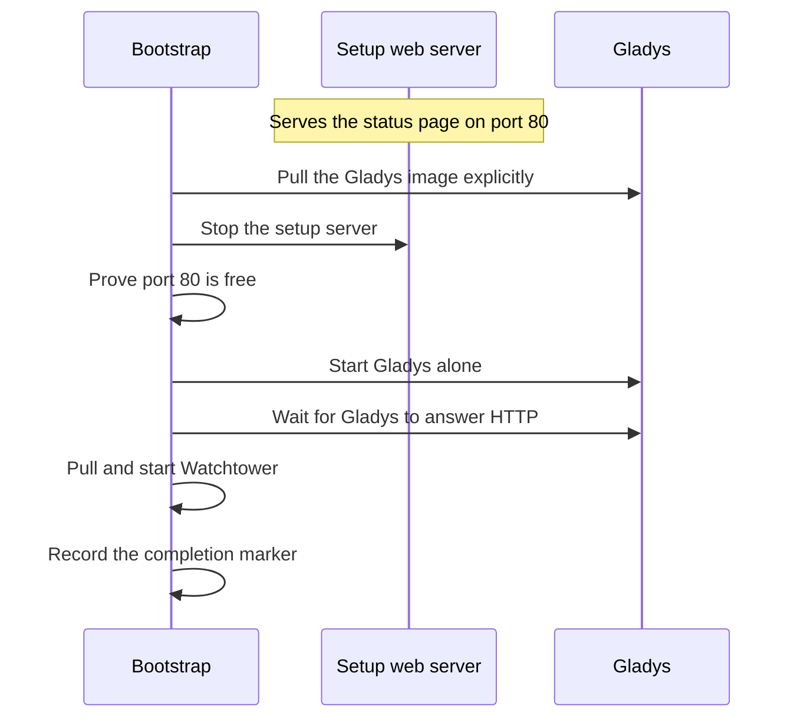

# Architecture

This document describes how the ISO is produced, what the installed appliance looks like, and how first boot provisions Gladys. The security rationale behind these choices is in [SECURITY.md](SECURITY.md).

## Build pipeline

The build is a chain of five scripts. Each stage authenticates or validates its inputs before the next stage may run, and the finished image is inspected against the authenticated base before it is accepted.


1. `fetch-ubuntu-base.sh` authenticates Canonical's archive keyring, the signed `SHA256SUMS` document, the selected Ubuntu 26.04 amd64 live-server ISO name, and the ISO bytes themselves. It always selects the newest 26.04 point release and re-verifies cached downloads.
2. `validate-autoinstall.sh` extracts the actual source catalog and Autoinstall schema from that verified ISO, enforces exactly one minimized server source, and runs the Canonical Subiquity 26.04 validator pinned to a full commit SHA.
3. `make-payload.sh` builds a deterministic, numeric-root tar archive from `payload/` inside a temporary tree and injects the independent installer `VERSION`. Only the `ci-smoke` profile receives test fixtures, including a deterministic Debian package whose blocking `postinst` makes dpkg power loss recovery observable in tests.
4. `build-iso.sh` syntax-checks GRUB, replaces the single unambiguous Canonical installer stanza with the **Install Gladys Assistant** stanza, adds only the `autoinstall` kernel argument, selects the entry by default behind a visible three second timeout, colours the menu in white on blue (the closest of GRUB's text-mode colours to Gladys blue), repairs the affected media checksum, prunes the restricted driver pool, maps the selected Autoinstall document and payload files into the image with xorriso, and replays the original boot equipment unchanged.
5. `inspect-iso.sh` re-extracts the finished image, checks the embedded hashes, profile, and GRUB structure, compares the signed boot chain files and El Torito metadata against the base ISO, and rejects any production payload contamination.

The Ubuntu shim, GRUB EFI binaries, kernel, initrd, EFI partition, and media integrity mechanism all remain Canonical's. The custom ISO changes configuration and adds a separately hashed target payload; it never rebuilds the boot chain.

The only content removed from the Canonical image is `/pool/restricted`, about 930 MiB of NVIDIA server drivers that a Gladys mini-PC never needs. This takes the media from roughly 2.9 GB down to about 1.95 GB. Autoinstall pins `drivers: install: false`, so Subiquity never asks for those packages. The signed `dists/` indexes stay byte-identical so the ISO package source still authenticates, and the matching `md5sum.txt` entries are dropped so the media check remains meaningful. Everything in `/pool/main`, including the kernel, GRUB, and OpenSSH packages used for an offline installation, is kept.

## Installed appliance

Subiquity installs a normal Ubuntu Server target from the minimized source. Production media present the locale, keyboard, storage, identity, and SSH screens in the normal installer order, with English locale preselected, the keyboard layout suggested from the chosen language, and the OpenSSH server selected by default. The storage screen is skipped on machines with a single internal disk (see below). The CI Autoinstall document differs only in that interactivity and in a throwaway CI account that answers the identity screen. The result is deliberately spartan:

- The hostname is `gladys`, whatever server name is typed on the identity screen.
- The Ubuntu Server installer has no time zone screen, so the system installs in UTC. Once online, first boot asks `geoip.ubuntu.com`, the geolocation service the Ubuntu installer itself queries, for the time zone of the public IP address, applies it with `timedatectl`, and writes it as `GLADYS_TZ` to `/opt/gladys/.env`, which Compose reads for the Gladys `TZ` variable. A zone already set on the host is kept, and any failure leaves UTC without blocking provisioning.
- The operator creates their own administrator account on the identity screen. The OpenSSH server is installed unless the operator unchecks it on the SSH screen, and password authentication follows Ubuntu Server's standard behavior. Root stays locked and the ISO embeds no account or password.
- Only security updates are enabled; automatic reboot and release upgrades are disabled.

An Autoinstall early command, `/gladys/single-disk-storage.py` on the media, runs before the first screen. It counts the internal disks with `lsblk`, ignoring USB, removable, hot-plugged, read-only, virtual, mounted, and smaller than 16 GiB devices. When exactly one remains, it removes `storage` from the interactive sections of `/autoinstall.yaml` and matches that disk by path; Subiquity reloads the document after early commands, so it installs there with an unencrypted LVM layout, the storage screen's own default, whose root volume uses the whole disk (`sizing-policy: all`). The interactive storage screen ignores the Autoinstall layout and always sizes the guided root volume to half the disk, at most 100 GiB; a late command grows that volume over the rest of its volume group (see below). The other sections stay interactive, so Subiquity still shows its destructive-action confirmation, right after the keyboard screen, before writing to any disk. Any other disk count, or any error, keeps the storage screen, and the command never fails the installation.

The Subiquity screens themselves keep Ubuntu's colours and wording: both are compiled into the signed Subiquity snap, which the image never modifies.

On the installed system, logins show the Gladys status instead of Ubuntu's welcome text. `/etc/update-motd.d/05-gladys` prints the same translated screen as the tty1 console (Gladys address, setup progress, or readiness) and stays silent if it fails, and `/etc/issue.d/gladys.issue` adds the Gladys address to the other virtual consoles' login prompt. At the end of first boot, `dpkg-divert` moves Ubuntu's documentation links and Ubuntu Pro advertising out of `/etc/update-motd.d`, which survives package updates without editing conffiles, and `motd-news.timer` is masked.

Autoinstall late commands first grow the guided `ubuntu-lv` root volume over its volume group with `lvextend --resizefs` when it has free space, leaving custom layouts and plain partitions untouched and never failing the installation. They then verify the payload SHA256 before extraction, extract it into the target with numeric ownership, enforce root ownership and explicit permissions, install the version file, enable the three Gladys systemd units, and mask the tty1 getty so the status console owns that terminal.

The three units are:

| Unit | Role |
| --- | --- |
| `gladys-firstboot.service` | Runs the provisioning bootstrap once, as root, until completion |
| `gladys-setup-web.service` | Serves the setup status page on port 80 until Gladys takes over |
| `gladys-console.service` | Renders localized phase progress and the LAN IPv4 address on tty1 |

## First boot state machine

`gladys-firstboot.service` owns provisioning under an exclusive process lock. The only skip condition is the completion marker `/var/lib/gladys-installer/completed`; the sibling `/var/lib/gladys-installer/state.json` exists solely for presentation and is never trusted for decisions. Both files are replaced atomically after syncing the file content and the containing directory, so a power cut cannot leave a half-written state.

The explicit phases are:

```text
PREFLIGHT > WAIT_NETWORK > APT_UPDATE > INSTALL_PACKAGES
  > START_SYSTEM_SERVICES > DOCKER_PREFLIGHT > PULL_GLADYS
  > START_GLADYS > VERIFY_GLADYS > START_WATCHTOWER
  > FINALIZE > READY
```

plus a terminal `FATAL` phase for deterministic configuration failures. Every operation is idempotent and reruns safely after an interruption. Transient network, APT, registry, or readiness failures retry with capped backoff; deterministic configuration failures stop the service with exit code 78, which systemd is configured not to restart.

First boot installs `docker.io`, `docker-compose-v2`, unattended upgrades tooling, CA certificates, and curl through non-interactive Ubuntu APT. Before pulling any application it verifies the package candidates, the system services, the Docker CLI, Compose, and the resolved Compose model.

Each phase is described from an operator's point of view in [OPERATIONS.md](OPERATIONS.md).

## Port 80 handoff

The setup page and Gladys both want port 80, so the bootstrap performs an explicit, verified handoff:



`gladys-setup-web.service` starts only while the completion marker is absent. It runs as a systemd dynamic user with heavy sandboxing, holds only the port binding capability, embeds its assets in memory, and exposes exactly three paths: `/`, `/status.json`, and `/healthz`.

Gladys must be running and answering HTTP before Watchtower is pulled and started. If a readiness attempt fails, the application is stopped and the setup page is restored where possible, so the user is never left staring at a dead port. Completion is recorded only after the Docker, Compose, application HTTP, and Watchtower checks have all succeeded.

## Container and update boundaries

The production Compose contract runs `gladysassistant/gladys:v5` privileged, with host networking, host cgroup access, the Docker socket, `/dev`, read-only udev events, and persistent application data at `/var/lib/gladysassistant`. These broad privileges are confined to Gladys because its hardware integration architecture requires them; the consequence for the threat model is spelled out in [SECURITY.md](SECURITY.md). Watchtower runs with `--label-enable`, so it only updates containers labelled `com.centurylinklabs.watchtower.enable=true`: in the Compose contract, that is Gladys and Watchtower itself. It follows a moving tag so that it keeps up with Docker API changes. It never updates containers created by Gladys integrations or other containers on the host. Container logs are size-capped both in the Compose contract and through the Docker daemon default in `/etc/docker/daemon.json`.

Ubuntu security updates are a separate boundary managed by `unattended-upgrades`. Automatic reboot and Ubuntu release upgrades are disabled. Rebuilding this installer updates installer logic or the authenticated Ubuntu base; it is never required for ordinary Gladys v5 updates.

## Discovery and user interfaces

During provisioning, the tty1 console publishes the current IPv4 address of the setup page. Once Gladys is ready, Gladys itself advertises `gladysassistant.local` through its integrated mDNS support; the installer does not run a second mDNS daemon. The console keeps showing the LAN IPv4 addresses as a fallback, so neither a graphical stack nor a maintenance login is ever required.

The selected Subiquity locale is read from `/etc/default/locale`. A shared, embedded catalogue translates the browser setup page into every language offered by the pinned Subiquity 26.04 language list, with an explicit English fallback for malformed or unknown locale values. tty1 uses the selected translation for scripts the Linux virtual console can render; Arabic, Hebrew, Tibetan, Japanese, and Chinese fall back to readable English copy there because the kernel console cannot provide the required shaping, bidirectional layout, or glyph coverage.

Both interfaces show coarse, truthful phase progress. Animated activity communicates that long package and container downloads are still running; the UI never invents byte counts it cannot know.
