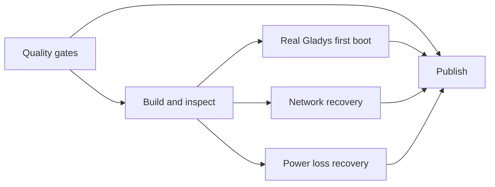

# Release procedure

Public releases are explicit version-tag operations. A successful weekly integration run never publishes media automatically.

## Prepare

1. Confirm the intended installer version is exactly the semantic version in `VERSION`. Gladys has an independent moving `v5` channel and must never appear as a numbered release in any metadata.
2. Review dependency and pinned-action updates, the current Canonical 26.04 source discovery, and the latest scheduled real-Gladys results.
3. Run the static checks, the unit tests, all three profile builds, finished production inspection, a UEFI install, a real Gladys and Watchtower first boot, offline recovery, and forced power loss recovery.
4. Push a test tag such as `vX.Y.Z-rc.1` to publish the test image, then complete the applicable physical tests in [HARDWARE-TEST-CHECKLIST.md](HARDWARE-TEST-CHECKLIST.md) with it. Never convert unchecked hardware into a support claim.
5. Create and push an annotated tag `vX.Y.Z` that exactly equals `VERSION`.

## Gates enforced by the workflow

The release workflow rejects non-semantic tags and any tag that does not match `VERSION`. Its publishing job cannot run unless every dependency has succeeded:



Only the publishing job receives write permissions; everything else runs with read-only repository access.

## Published artifacts

GitHub caps release assets at 2 GiB per file, which leaves too little headroom for the installer image (about 1.8 GiB), so the ISO itself is published on Cloudflare R2 (bucket `gladys-assistant-os-images`, served at `download.gladysassistant.com`). Each channel has one fixed object that every publication overwrites, so the bucket never keeps old images:

| Channel | Trigger | Image | Checksum |
| --- | --- | --- | --- |
| Production | `vX.Y.Z` tag | `https://download.gladysassistant.com/gladys-assistant-installer-amd64.iso` | same URL plus `.sha256` |
| Test | `vX.Y.Z-suffix` tag, for example `v0.2.0-rc.1` | `https://download.gladysassistant.com/test/gladys-assistant-installer-amd64.iso` | same URL plus `.sha256` |

The R2 `.sha256` names the fixed object. Objects are uploaded with `Cache-Control: no-cache` so the CDN never serves a stale checksum. A test tag runs `test-image.yml`: the same quality gates, the production and `ci-real` builds, and a real Gladys first boot. It creates no GitHub release.

Exactly these files are attached to a GitHub release:

```text
gladys-assistant-installer-vX.Y.Z-amd64.iso.sha256
build-info.json
```

`build-info.json` records the installer version, the full Git commit, the architecture, the Ubuntu series, the selected Ubuntu ISO filename and SHA256, and the UTC build timestamp. It contains no Gladys version. The publish job checks the `.sha256`, creates GitHub artifact provenance for the image, uploads it to R2, and uses `gh release create --verify-tag`.

The workflows need two repository secrets: `R2_ACCOUNT_ID`, the Cloudflare account ID, and `R2_STORAGE_TOKEN`, the value of an R2 API token with write access to the bucket. `scripts/publish-r2.sh` derives the S3 credentials from the token as Cloudflare documents: the token id, obtained from the token verification endpoint, is the access key ID, and the SHA-256 of the token value is the secret access key.

## Verifying a release as a user

Download the image and its checksum, then verify from the containing directory:

```bash
curl -fLO https://download.gladysassistant.com/gladys-assistant-installer-amd64.iso
curl -fLO https://download.gladysassistant.com/gladys-assistant-installer-amd64.iso.sha256
sha256sum -c gladys-assistant-installer-amd64.iso.sha256
```

For a public repository, verify GitHub provenance with an authenticated, current GitHub CLI:

```bash
gh attestation verify \
  gladys-assistant-installer-amd64.iso \
  --repo GladysAssistant/ubuntu-server-gladys
```

Both checks are required release evidence: the SHA256 detects byte changes, and the attestation binds the subject digest to the GitHub Actions build identity. Inspect `build-info.json` and confirm its `git_commit` matches the release tag before distributing the image further.

## Post-release

Flash the exact released ISO and repeat a physical UEFI and Ethernet installation on representative hardware. Record the results and limitations. Never silently replace assets on an existing tag: fixes require a new installer version and a new tag. Only the latest release is downloadable from R2.
